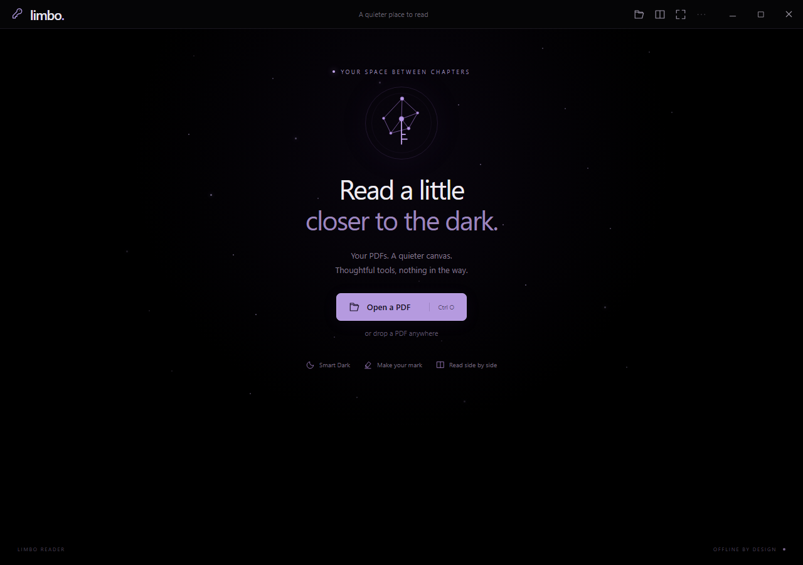
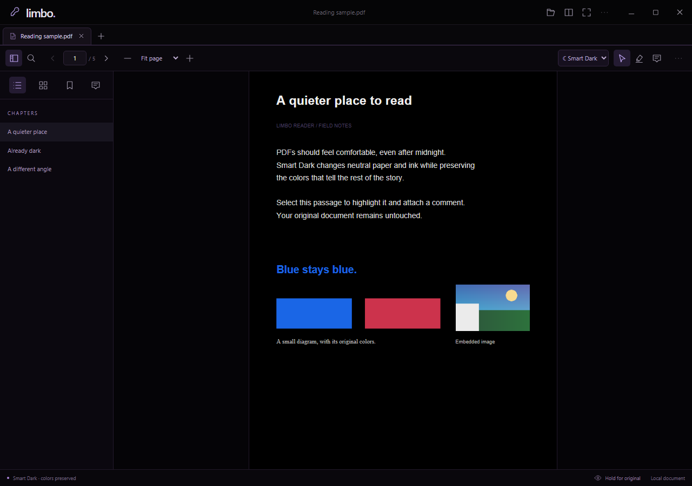
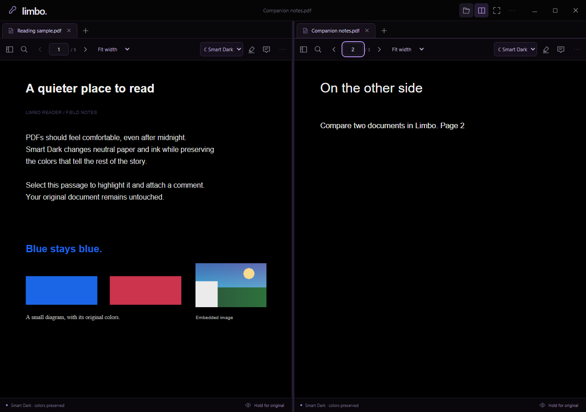

# Limbo

**A quieter place to read.** An offline PDF reader for Windows 11, with an OLED canvas and quiet astral accents.



## Install

Download **[Limbo-Setup.exe from Releases](https://github.com/rajsrule/limbo-pdf-reader/releases/latest)** and run it. Limbo installs for your Windows account, adds a Start menu entry, and registers as an **Open with** option for PDFs. Open Limbo and drop in a PDF, or right-click a PDF → Open with → Limbo. Choosing it as your default reader remains your choice in Windows Settings.

Windows 11 x64 is the initial target. The installer uses Microsoft Edge WebView2 already installed on most Windows 11 systems and can obtain it from Microsoft if missing. Reading works offline after setup. Initial releases are unsigned and may show a Windows reputation warning.

## Reading

- **Smart Dark:** neutral paper becomes black and neutral ink becomes soft white, while colors and embedded images retain their original pixels. Already-dark pages, scans, and complex artwork are preserved. Choose **Original** or **Full Invert** whenever needed; hold **Original** in the status bar for a temporary comparison.
- **Your place, remembered:** page, zoom, rotation, color mode, bookmarks, and per-page original-color overrides are stored locally.
- **Reading tools:** continuous/single-page views, fit width/page, text selection, search, outline chapters, lazy thumbnails, bookmarks, fullscreen, and focus mode.
- **Markup:** highlight text and attach a comment. Drafts save locally; **Export annotated PDF** writes a separate shareable PDF, with original page colors. Original files are never overwritten.



## Two documents, one space

Use the split button or **Ctrl+\\** to split the window. Each pane has its own tab group, navigation, zoom, and search. Drag tabs between groups; drag the divider to resize it, or double-click to return to 50/50. **F6** switches panes. Toggle split again to merge the groups.

Right-click a tab → **Move to new window**, or press **Ctrl+Shift+N**. You can also drag a tab outside the window. The original tab remains until its destination acknowledges receiving the document. Use Windows snapping with **Win+Left/Right**, **Win+Z**, or the Maximize hover picker.



## Shortcuts

| Action | Shortcut |
|---|---|
| Open PDF | Ctrl+O |
| Find | Ctrl+F |
| Save local draft | Ctrl+S |
| Export annotated copy | Ctrl+Shift+S |
| Split / merge panes | Ctrl+\\ |
| Switch pane | F6 |
| Move tab to new window | Ctrl+Shift+N |
| Next / previous tab | Ctrl+Tab / Ctrl+Shift+Tab |
| Close tab | Ctrl+W |
| Bookmark page | Ctrl+D |
| Print original colors | Ctrl+P |
| Fullscreen | F11 |
| Leave focus mode | Escape |
| Shortcut reference | ? |

## Privacy and local drafts

Limbo has no account requirement, telemetry, cloud upload, or embedded PDF scripting. Web links open in your system browser. Draft PDFs, reading settings, and recent paths are stored under `%LOCALAPPDATA%\io.github.rajsrule.limbo`. Drafts can contain the document's contents and your comments; clearing the recent list only clears that list. The uninstaller does not silently erase your drafts.

Document identity uses the canonical path, file size, modification time, and header digest. A changed source receives a different identity, and previous drafts are preserved separately. Keep an exported copy when you need portable or archival notes.

## Build from source

Prerequisites: Node.js 24, stable Rust (MSVC), Microsoft C++ Build Tools with the Windows SDK, and WebView2. Dependencies are pinned in `package-lock.json` and `src-tauri/Cargo.lock`.

```powershell
npm ci
npm run tauri dev
```

Build the installer:

```powershell
cargo fetch --manifest-path src-tauri/Cargo.toml --locked
node scripts/notices.mjs
npm run tauri build -- --bundles nsis
```

The setup executable appears under `src-tauri/target/release/bundle/nsis/`. A tagged `v*` push runs the Windows release workflow and publishes `Limbo-Setup.exe` plus its SHA-256 checksum.

For frontend-only development, `npm run dev` opens a browser-compatible reader. Native file associations, window transfer, and Windows Snap Layouts require the desktop build. Browser preview stores drafts in browser storage, which has smaller quotas.

## Verification

```powershell
npm run fixtures
npm test
npm run build
npx playwright install chromium
npm run test:e2e
cargo test --manifest-path src-tauri/Cargo.toml --locked
```

Fixtures are original generated documents covering digital text, dark pages, colors, raster imagery, scans, transparency, rotation, outlines, and a 600-page document. See [validation notes](docs/VALIDATION.md) for actual results and limits.

## Smart Dark implementation

`scripts/prepare-pdf.mjs` deterministically prepares the pinned PDF.js compatibility build and local assets. It asserts every renderer replacement occurs exactly once, so upstream changes fail installation rather than silently damaging color rendering. The isolated hooks remap only low-chroma solid drawing colors and the implicit page background. Image drawing is untouched. Page analysis is cached and advanced compositing uses original rendering. This is a conservative reading aid, not a promise of semantic understanding of every PDF's artwork.

Insertable note pages, OCR, cloud sync, AI chat, PDF text editing, and auto-updates are outside this release.

## License

MIT for Limbo's original code. See [third-party notices](THIRD_PARTY_NOTICES.md) and `notices/` for dependencies. Artwork is original; no Geometry Dash assets or music are included.
